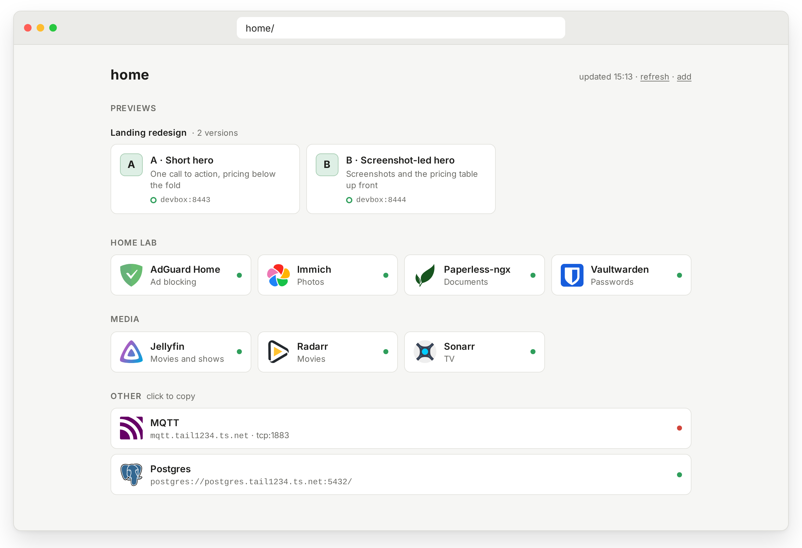

<div align="center">


# tailhome

The start page that builds itself from your tailnet.

[](https://github.com/mickey/tailhome/releases)
[](https://github.com/mickey/tailhome/releases)
[](LICENSE)

</div>

tailhome is a start page for your homelab and your coding agents' work. It finds your [Tailscale Services](https://tailscale.com/docs/features/tailscale-services), device apps and agent previews, then lists them at `http://home/`. Each web app gets a link; the rest, such as SSH or Postgres, get a copyable address.

It runs as one container (about 12 MB, Linux amd64, arm64 and armv7) or one binary (also macOS and Windows). It [joins your tailnet itself](https://tailscale.com/docs/features/tsnet), so it needs no Tailscale on the host and no API credentials.

tailhome is pre-1.0 with one maintainer, who runs it daily. Settings and defaults may change between 0.x releases; read the [release notes](https://github.com/mickey/tailhome/releases) before upgrading.

<picture>
  <source media="(prefers-color-scheme: dark)" srcset="docs/screenshot-dark.png">
  
</picture>

<sub>Groups and descriptions shown here use overrides or OAuth. New installs group apps under Apps.</sub>

## Why tailhome

tailhome keeps your app list up to date by discovering what you publish on your tailnet with `tailscale serve`, [DockTail or TSDProxy](docs/apps.md#publish-container-apps). Your coding agents' work appears too. With the [tailnet-preview skill](skills/tailnet-preview/), an agent publishes what it built as a private HTTPS preview, and tailhome lists it above your apps with the title and description the agent chose. Ask for three versions and they share one heading, as A, B and C.

It is a launcher, not a dashboard. [Homepage](https://gethomepage.dev) and [Glance](https://github.com/glanceapp/glance) have widgets and feeds; tailhome can [feed them its app list](docs/customize.md#homepage-and-glance).

On each device, tailhome tries only port 443 and the [preview ports](docs/setup.md#preview-ports) you allow. It does not read Docker labels or look behind reverse proxies.

## Which apps appear

- A Tailscale Service tailhome can reach, or every Service with an OAuth client.
- An app on its own tailnet device that answers HTTPS on port 443.
- A preview a coding agent published with `tailscale serve`, on port 443 or on a [preview port](docs/setup.md#preview-ports) you allow.

An app at `nas:8080` appears once you [publish it with one command](docs/apps.md#app-on-another-port). See [discovery rules, certificates and publishing tools](docs/apps.md).

## Quick start

Before you start:

- Enable MagicDNS and HTTPS Certificates in your [DNS settings](https://console.tailscale.com/admin/dns).
- On the Docker host, use Docker Compose 2.24.0 or later.
- On devices that open Services, use Tailscale 1.86 or later. On Linux before 1.94, also run `sudo tailscale set --accept-routes`.

Create [`compose.yaml`](compose.yaml). The `env_file` and `./config` lines are optional:
`.env` holds OAuth credentials, and `config/overrides.yaml` holds tile overrides.

```yaml
services:
  tailhome:
    image: ghcr.io/mickey/tailhome:latest
    env_file: [{ path: .env, required: false }] # optional OAuth client, see docs/setup.md
    environment:
      TZ: Etc/UTC # your time zone, for the "updated" time
      TAILHOME_OVERRIDES: /config/overrides.yaml
    volumes:
      - tailhome-data:/data
      - ./config:/config:ro # put overrides.yaml here
    restart: unless-stopped

volumes:
  tailhome-data:
```

```sh
mkdir -p config
docker compose up -d
docker compose logs -f
```

Open the login link in the logs to add tailhome to your tailnet. When the logs show `serving https://home.<tailnet>.ts.net`, open `http://home/` from a tailnet device. Keep the trailing slash. It redirects to that HTTPS address. Open a tile to launch an app; see [page controls, health dots and shortcuts](docs/apps.md#using-the-page).

> [!NOTE]
> Disable key expiry for the new `home` device on the [Machines](https://console.tailscale.com/admin/machines) page. If `home` is taken, use the address in the logs, such as `home-1`. Keep the state volume: deleting it creates a new node.

tailhome needs no host ports, Docker socket or extra capabilities. See the setup guide for [docker run, binaries, systemd and unattended login](docs/setup.md).

## Previews from coding agents

With the optional [tailnet-preview skill](skills/tailnet-preview/), a coding agent publishes the app it is working on with `tailscale serve`, hands you a private HTTPS link and later removes only what it published. tailhome lists each preview at the top of the page, with the title and description the agent chose.

The skill runs on the machine where the app runs, your laptop or a remote server, and needs Python 3.9 or later and the Tailscale CLI. It also works without tailhome.

> [!IMPORTANT]
> Extra preview ports are off by default. To list previews on the skill's suggested range, add this to tailhome's `environment:` in `compose.yaml`, then run `docker compose up -d`:
>
> ```yaml
> TAILHOME_PREVIEW_PORTS: 8443-8452
> ```
>
> Without it, agents can still publish previews on those ports and hand you links, but `home/` won't show them. A preview on port 443 with a card appears either way. See [preview ports](docs/setup.md#preview-ports) for other ranges and limits.

Install it where your agent finds skills. Many clients read `~/.agents/skills`; Claude Code reads `~/.claude/skills`:

```sh
git clone --depth 1 https://github.com/mickey/tailhome.git
mkdir -p ~/.agents/skills ~/.claude/skills
cp -R tailhome/skills/tailnet-preview ~/.agents/skills/
ln -s ~/.agents/skills/tailnet-preview ~/.claude/skills/tailnet-preview
```

Or run `npx skills add mickey/tailhome --skill tailnet-preview`. The [installation reference](skills/tailnet-preview/references/serve.md#installation-and-updates) covers other clients, the Tailscale CLI on macOS and Python.

The first time, the agent asks which HTTPS ports it may use and suggests the same range, 8443-8452. Your approval in the chat is enough. To skip the question next time, set `TAILNET_PREVIEW_PORTS` in the agent's environment.

A preview is private to your tailnet, not to you: anyone your Tailscale policy lets in can open it, and anyone who can open tailhome sees its title. It runs only while the app does, so keep that machine awake. See [preview privacy and lifetime](docs/apps.md#previews).

## Customize tiles

Put `overrides.yaml` in `config/` to change labels, groups, icons and links, or hide an entry:

```yaml
jellyfin:
  group: Media
  description: Films and TV
postgres:
  hidden: true
```

See [all fields](docs/customize.md) and [`overrides.example.yaml`](overrides.example.yaml). For groups and descriptions from the admin console, [set up an OAuth client](docs/setup.md#set-up-oauth).

## Documentation

- [Set up tailhome](docs/setup.md)
- [Apps and discovery](docs/apps.md)
- [Customize tiles](docs/customize.md)
- [Troubleshooting](docs/troubleshooting.md)

## Security and privacy

> [!WARNING]
> Anyone who can open tailhome sees every listed app and preview, with its name, description and status, on the page and both JSON endpoints, including apps their own access rules block. Restrict access to tailhome accordingly. Hiding an entry hides it for everyone; it does not revoke access to the app.

- Every five minutes by default, tailhome checks port 443 and your preview ports on every device it may reach in your tailnet, other members' laptops and phones included. Apps on port 443 get `GET /`; previews and other ports get a TLS handshake only. When tailhome first finds an endpoint, when one comes back and on a manual refresh, it also reads `/.well-known/tailhome.json`. Requests name `tailhome` in their User-Agent. A nonempty `TAILHOME_DEVICE_TAGS` filter excludes untagged laptops too; see [discovery and device identity](docs/setup.md#optional-list-previews-in-tailhome) before setting it. Use `TAILHOME_DEVICES=off` to stop device discovery.
- Icons load from `cdn.jsdelivr.net`. To avoid it, set `icon` overrides to your own URLs.
- Like other Tailscale nodes, tailhome uploads diagnostic logs to Tailscale. Set `TS_NO_LOGS_NO_SUPPORT=true` to stop uploads.
- Previews on different ports of one device share its cookies. Don't publish an untrusted preview on a device whose other apps keep you logged in.

Report vulnerabilities through [SECURITY.md](SECURITY.md). To contribute, see [CONTRIBUTING.md](CONTRIBUTING.md). Licensed under [MIT](LICENSE).
