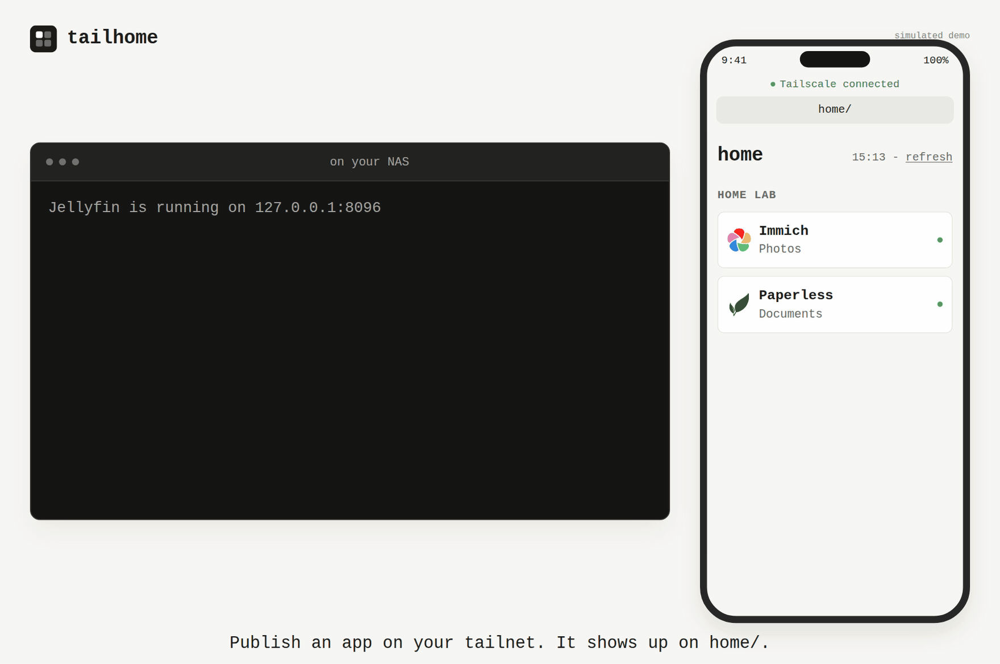
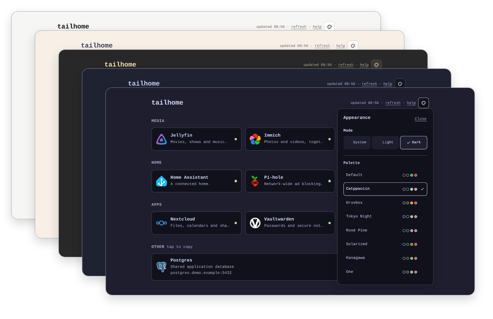
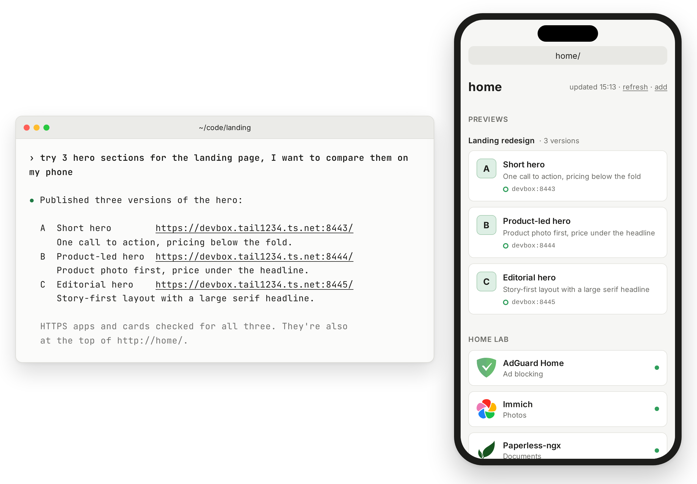
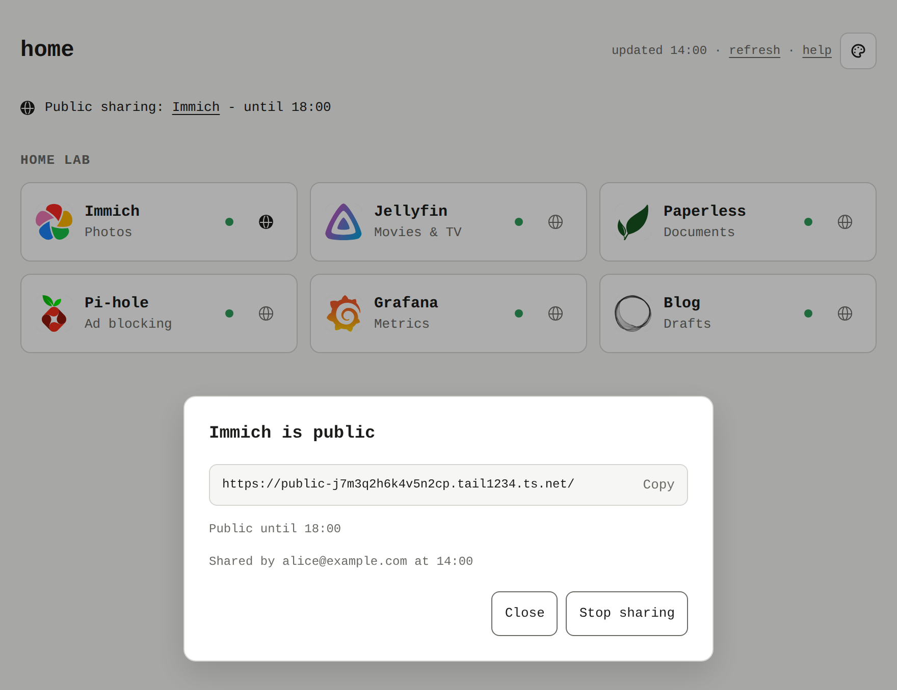

#  tailhome

**The start page that builds itself from your [tailnet](https://tailscale.com/docs/concepts/tailnet), plus live HTTPS previews from your coding agents.**

Stop editing YAML every time you spin up a container or start a dev server. Run `tailhome` once to get **http://home/** on every Tailscale device: your NAS, homelab and team apps appear automatically with icons and live health checks, and your coding agents can publish side-by-side branch previews (`A`, `B`, `C`) straight to your phone.



[](https://github.com/mickey/tailhome/releases) [](https://github.com/mickey/tailhome/actions/workflows/ci.yml) [](LICENSE)

`tailhome` (the start page) and `tailnet-preview` (the coding-agent skill) work alone or together:

| What you want | What to install |
|---|---|
| **Auto-discovered start page** for your NAS, homelab or team | [Run `tailhome`](#quick-start) (1 container, no agent required) |
| **Private phone links** from Claude Code, Codex, Gemini CLI or omp | [Install `tailnet-preview`](#previews-from-coding-agents) (1 command, no `tailhome` server required) |
| **Apps and live agent previews** in one place | Install both and [enable preview ports](docs/setup.md#optional-list-previews-in-tailhome) |

## Quick start

1. Enable MagicDNS and HTTPS Certificates in your [Tailscale DNS settings](https://console.tailscale.com/admin/dns), then start `tailhome` on any machine running Docker:

   ```sh
   docker run -d --name tailhome --restart unless-stopped \
     -v tailhome-data:/data ghcr.io/mickey/tailhome:latest
   docker logs -f tailhome
   ```

   Open the login link printed in the logs to join your tailnet.

2. When the logs show `serving https://home.<tailnet>.ts.net`, open **http://home/** (with the trailing slash) from any device on your tailnet. If `home` was already taken, use the hostname shown in the logs.

3. **Publish your first app.** On any machine with Tailscale installed, expose a local port to your tailnet:

   ```sh
   tailscale serve --bg --https=443 8080
   ```

   On Linux, run with `sudo` or grant operator access once with `sudo tailscale set --operator=$USER`. Click **refresh** on `http://home/` and your app tile appears.

Teammates and family only need Tailscale and [access in your tailnet policy](https://tailscale.com/docs/features/access-control). See [Setup](docs/setup.md) for Docker Compose, prebuilt binaries, systemd, OAuth (`svc:home`) and unattended auth keys.

## Why tailhome

- **Auto-discovered catalog and health checks.** Finds [Tailscale Services](https://tailscale.com/docs/features/tailscale-services) and HTTPS device apps on your tailnet, matches [dashboard-icons](https://github.com/homarr-labs/dashboard-icons), and probes health over Tailscale.
- **No exposed ports, Docker socket or reverse proxy.** Joins your tailnet in userspace via `tsnet` inside a static, non-root container; the Docker host does not even need Tailscale installed.
- **Live previews from coding agents.** Ask *"Can I see these three versions on my phone?"* Your agent publishes private HTTPS previews over Tailscale Serve, attaches `A`/`B`/`C` comparison cards, and cleans up its mappings when done.
- **Built for phones and keyboards.** Install `http://home/` as a mobile web app, jump to any app from the address bar with `home/go/jellyfin`, or copy SSH/Postgres addresses in one click.
- **Public links when you need them.** Admins can [share an app on the internet](docs/setup.md#public-sharing) for a set time and stop it at any time.
- **Eight color palettes in light and dark.** Switch between Default, Catppuccin, Gruvbox, Tokyo Night, Rosé Pine, Solarized, Kanagawa and One.



**When to use something else:** `tailhome` only lists what lives on your tailnet. For CPU graphs, weather widgets or external bookmarks, use Homepage, Glance, Homarr or Dashy, and optionally [feed them your tailnet app list](docs/integrations.md) via `/api/list.json`.

## Previews from coding agents

Compare branches on your phone or review a UI running on a remote devbox without port forwarding, public tunnels, or staging deploys.

> [!TIP]
> Paste this into Claude Code, Codex, Gemini CLI, OpenCode or omp:
>
> ```text
> Install the tailnet-preview skill (npx skills add mickey/tailhome --skill tailnet-preview -g), then show me this app on my phone.
> ```

Or install the skill yourself (requires Node 22.20+ for the installer; the skill itself uses Python 3.9+ and the Tailscale CLI on Linux or macOS):

```sh
npx skills add mickey/tailhome --skill tailnet-preview -g
```

Restart your agent so it loads the skill, then ask:

- *"Can I see this on my phone?"*
- *"Publish three versions of the new pricing hero so I can compare them."*
- *"Remove the landing previews."*

On first run, the agent checks your Tailscale setup and asks which HTTPS ports it may use (such as `8443-8452`), leaving existing mappings untouched. Each preview gets a private `https://<machine>.<tailnet>.ts.net:<port>/` link and a `/.well-known/tailhome.json` card so `http://home/` groups versions side by side with `A`, `B`, `C` badges.

<picture>
  <source media="(prefers-color-scheme: dark)" srcset="docs/agents-dark.png">
  
</picture>

Previews are private to your tailnet and stay live while your machine is awake and the dev server is running. See the [skill guide](skills/tailnet-preview/README.md) for Claude Code, omp and Gemini CLI plugin commands, an `AGENTS.md` / `CLAUDE.md` snippet to make previews automatic, and [preview discovery setup](docs/setup.md#preview-ports).

## Share an app publicly

Need to show an app or an agent preview to someone outside your tailnet? Click the globe on its tile. tailhome gives it a public HTTPS address through [Tailscale Funnel](https://tailscale.com/kb/1223/funnel) for 1 hour, 8 hours, 24 hours, 7 days or until you stop it. Previews are limited to 24 hours and stop sharing when they are removed or change. Stopping closes public access at once.

<picture>
  <source media="(prefers-color-scheme: dark)" srcset="docs/sharing-dark.png">
  
</picture>

Set `TAILHOME_SHARE_ADMINS` to enable sharing for the admins you name. It needs an OAuth client that can create auth keys and a few lines in your tailnet policy. See [public sharing](docs/setup.md#public-sharing).

## What appears on `home/`

| Source | How it works |
|---|---|
| **[Tailscale Services](https://tailscale.com/docs/features/tailscale-services)** | Discovered automatically from the local netmap. Add a read-only [OAuth client](docs/setup.md#set-up-oauth) to list every Service on the tailnet with tags as groups and descriptions on tiles. Non-web Services (SSH, Postgres, Redis) appear under **Other** with one-click copy. |
| **Device apps** | Any tailnet device serving HTTPS on port `443` with a valid certificate appears as a tile with live health status. Container publishers like [DockTail](docs/integrations.md#docktail), TSDProxy, tsbridge and ScaleTail work out of the box. |
| **Agent & dev previews** | Any app on [`TAILHOME_PREVIEW_PORTS`](docs/setup.md#preview-ports) (or on port `443` with a `preview: true` card) appears at the top under **Previews** while its server responds, and disappears cleanly when stopped. |

Need custom names, groups, icons or ordering? Drop an optional [`config/overrides.yaml`](docs/customize.md#overrides) next to your config.

## Documentation

| Guide | Covers |
|---|---|
| [Setup and configuration](docs/setup.md) | Docker Compose, binaries, systemd, OAuth (`svc:home`), public sharing via Funnel, preview ports and environment variables |
| [Apps, previews and page controls](docs/apps.md) | How Services, devices and preview cards (`/.well-known/tailhome.json`) are discovered, health indicators and container publishers |
| [Customization and JSON API](docs/customize.md) | `overrides.yaml` reference, `/go/<name>` shortcuts, `/api/list.json` and `/api/services.json` |
| [Integrations](docs/integrations.md) | Ready-to-paste widgets for Homepage and Glance, plus DockTail container labels |
| [`tailnet-preview` skill](skills/tailnet-preview/README.md) | Agent installation, plugins, automatic `AGENTS.md` rules, with [troubleshooting](skills/tailnet-preview/references/serve.md#troubleshooting-boundaries) in the reference |
| [Troubleshooting](docs/troubleshooting.md) | Fixes for DNS, certificates, OAuth, missing tiles and Serve permissions |

## Security and privacy

`tailhome` has no login of its own and no analytics or telemetry. Your [Tailscale access policy](https://tailscale.com/docs/features/access-control) controls who can open `home/` and each individual app.

Everyone who can open `tailhome` sees the same catalog (app and preview names, descriptions, addresses and up/down status) on the page and JSON endpoints, even for apps their own Tailscale policy blocks them from opening. Hiding a tile in `overrides.yaml` removes it from the page, not from the network.

Device discovery probes reachable devices on your tailnet, including other members' laptops (`TAILHOME_DEVICES=off` disables this). Listing Services with tags and descriptions only needs OAuth `Services: Read`; add `Auth Keys: Write` only for unattended enrollment or [opt-in public sharing](docs/setup.md#public-sharing).

Browsers share cookies across all ports on the same hostname, including `HttpOnly` cookies. Only publish trusted code on machines where you stay signed in to other apps. Logs can contain the initial login link: open it yourself and do not share it.

See [Security and network requests](docs/setup.md#security-and-network-requests) for icon CDN privacy and Tailscale diagnostic logs, and [SECURITY.md](SECURITY.md) to report vulnerabilities.

## Status

Actively maintained; pre-1.0 releases (`v0.x`) ship container images (`linux/amd64`, `linux/arm64`, `linux/arm/v7`) and static binaries for Linux, macOS and Windows.

## Is it any good?

[Yes.](https://news.ycombinator.com/item?id=3067434)

---

Tailscale is a trademark of Tailscale Inc. tailhome is not affiliated with or endorsed by Tailscale.
