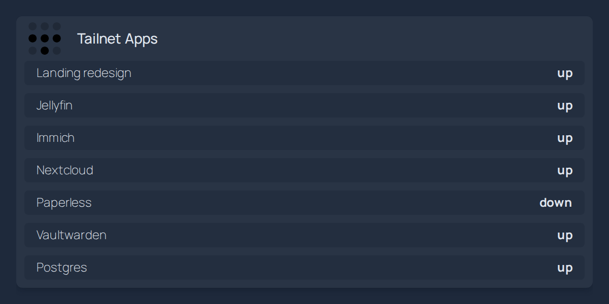
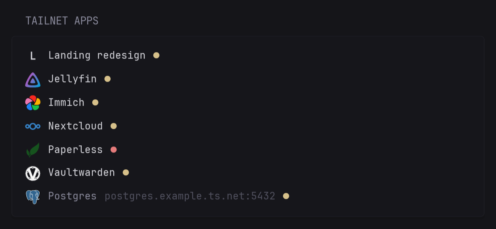

# Integrations

[Back to the README](../README.md).

These recipes connect tailhome to other self-hosted tools. The Homepage and Glance recipes were tested against a sample `/api/list.json`, with the versions named in their sections.

A dashboard that reads tailhome must be on your tailnet and allowed to reach tailhome by your [access rules](https://tailscale.com/docs/features/access-control). Containers often cannot resolve the short name `home`, so the examples use the full address: replace `home.<tailnet>.ts.net` with the address in tailhome's logs. A dashboard shared outside your tailnet shows your app names to everyone who can open it.

## Homepage

[Homepage](https://gethomepage.dev/) can list your tailnet apps, with each app's status, through its [custom API widget](https://gethomepage.dev/widgets/services/customapi/). Add this to `services.yaml` (tested with Homepage 2.7.0):

```yaml
- Tailnet:
    - Tailnet Apps:
        icon: tailscale.svg
        href: https://home.<tailnet>.ts.net/
        widget:
          type: customapi
          url: https://home.<tailnet>.ts.net/api/list.json
          display: dynamic-list
          mappings:
            name: label
            label: status
            target: "{url}"
```



Homepage lists every entry from `/api/list.json`, including previews. Its list view has no per-item icons. Other rows show a name and status, without a link or connection details.

## Glance

[Glance](https://github.com/glanceapp/glance) can list your tailnet apps with their icons, links and status dots through its [custom API widget](https://github.com/glanceapp/glance/blob/main/docs/custom-api.md). Add this under a column's `widgets` in `glance.yml` (tested with Glance 0.8.7):

```yaml
- type: custom-api
  title: Tailnet Apps
  title-url: https://home.<tailnet>.ts.net/
  url: https://home.<tailnet>.ts.net/api/list.json
  cache: 1m
  template: |
    <ul class="list list-gap-10 collapsible-container" data-collapse-after="10">
    {{ range .JSON.Array "" }}
      <li class="flex items-center gap-10">
        {{ if or (.String "iconDark") (.String "icon") }}{{ else }}<span class="color-highlight" style="width:20px;height:20px;display:grid;place-items:center"><b>{{ findMatch "^." (.String "label") }}</b></span>{{ end }}
        {{ if .String "url" }}<a class="color-highlight" href="{{ .String "url" }}">{{ .String "label" }}</a>{{ else }}<span>{{ .String "label" }}</span> <span class="color-subdue">{{ .String "copy" }}</span>{{ end }}
        <span class="{{ if eq (.String "status") "up" }}color-positive{{ else if eq (.String "status") "down" }}color-negative{{ else }}color-subdue{{ end }}" title="{{ .String "status" }}">●</span>
      </li>
    {{ end }}
    </ul>
```



Other rows show their connection details as text, and apps without an icon show their first letter. The `up` dot uses your theme's positive color, gold in the default theme, like Glance's own monitor widget. The widget uses each icon's variant for dark backgrounds when one exists; with a light theme, replace both `or (.String "iconDark") (.String "icon")` with `(.String "icon")`.

## DockTail

[DockTail](https://github.com/marvinvr/docktail) publishes Docker containers as [Tailscale Services](https://tailscale.com/docs/features/tailscale-services). Its labels can also set each Service's description and [tags](https://tailscale.com/docs/features/tags). With tailhome's [read-only OAuth client](setup.md#set-up-oauth), the description appears on the tile and the first tag becomes its group, unless an override sets them: `tag:media` becomes Media.

```yaml
labels:
  docktail.service.enable: "true"
  docktail.service.name: jellyfin
  docktail.service.port: "8096"
  docktail.service.description: "Films and TV"
  docktail.tags: "tag:media"
```

DockTail needs its own API credentials to write descriptions and tags; never give them to tailhome. Without `docktail.tags`, DockTail applies its default tags, `tag:container` unless you changed them, and those tiles share one group. Tags also take part in access rules, so to change only the group, use a `group` [override](customize.md#overrides). See DockTail's [label reference](https://docktail.org/docs/labels/).

For your own tools, see the [JSON format](customize.md#json-format).
