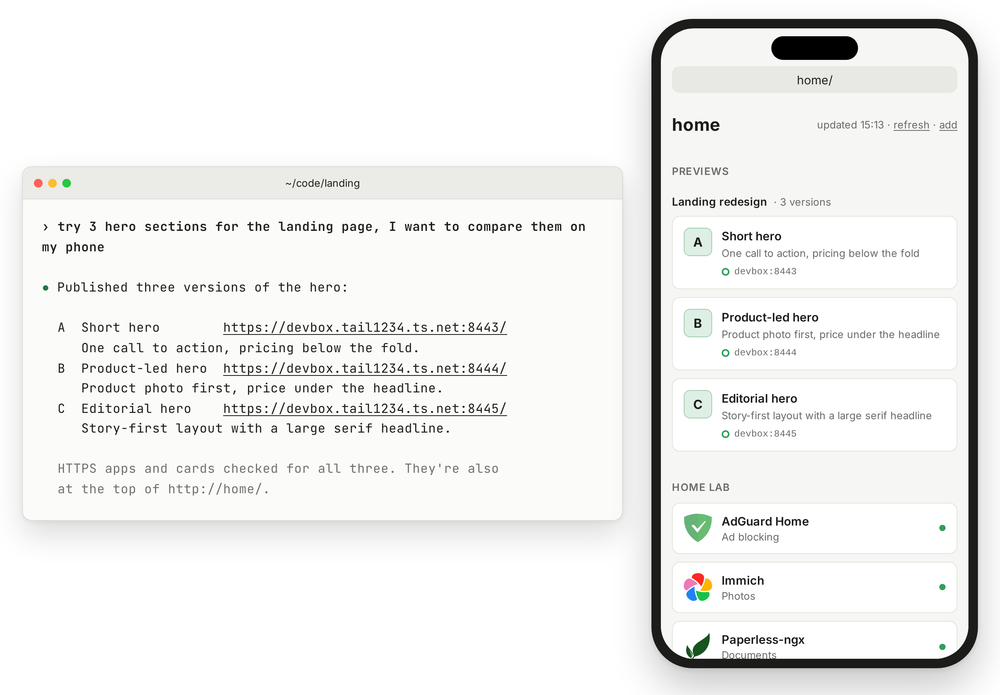

# tailnet-preview

Get a private HTTPS link to your local app with [Tailscale Serve](https://tailscale.com/kb/1312/serve). A laptop and a phone are enough; no server or tailhome needed.

## Requirements

Run the skill on the machine hosting your app. You need:

- Linux or macOS and Python 3.9 or later.
- Tailscale connected on that machine and your phone, with the CLI available on the publishing machine.
- MagicDNS and HTTPS Certificates enabled by your tailnet administrator.
- Permission to change Serve. See [permission errors](references/serve.md#read-preflight-results).

Keep your laptop awake and the app running. Reviewers need Tailscale, not the skill or tailhome; your [access rules](https://tailscale.com/docs/features/access-control) control who can open previews.

## Install

Install on the app and agent's machine. The installer needs Node 22.20 or later; choose your coding agent when asked:

```sh
npx skills add mickey/tailhome --skill tailnet-preview -g
```

Reload or restart your client, then ask:

> Can I see this on my phone?

The agent asks you to approve HTTPS ports, suggesting 8443-8452. To save your approval, set `TAILNET_PREVIEW_PORTS` in the agent's launch environment. Port 443 must be free and needs explicit approval.

For [installation without Node](references/serve.md#installation-and-updates), copy the whole skill directory to your agent's skills folder.

## Plugins

Claude Code:

```text
/plugin marketplace add mickey/tailhome
/plugin install tailnet-preview@tailhome
```

omp:

```sh
omp plugin marketplace add mickey/tailhome
omp plugin install tailnet-preview@tailhome
```

Gemini CLI:

```sh
gemini extensions install https://github.com/mickey/tailhome --ref main
```


## Use with tailhome

Enable [preview discovery](../../docs/setup.md#optional-list-previews-in-tailhome) to list previews in tailhome.

| Setting | Set on | Purpose |
|---|---|---|
| `TAILNET_PREVIEW_PORTS` | Agent's environment | Approved publishing ports; otherwise the agent asks |
| `TAILHOME_PREVIEW_PORTS` | tailhome | Extra HTTPS ports to discover; does not approve publishing |
| `TAILHOME_URL` | Agent's environment | Optional full HTTPS tailhome address to check the listing |

<picture>
  <source media="(prefers-color-scheme: dark)" srcset="../../docs/agents-dark.png">
  
</picture>


## Privacy and cleanup

Anyone who can open tailhome sees every listed preview's metadata and link, even if they cannot open the app. Keep secrets out of titles and descriptions.

Browsers send a hostname's cookies to every port, including `HttpOnly` cookies. Publish only trusted app code on a machine where you stay signed in to other apps.

Previews stay published until removed. Ask "remove the landing previews" when finished; hiding them in tailhome does not revoke access.

Cleanup removes only unchanged mappings the skill recorded, leaving apps, worktrees and packages intact. The skill does not use Funnel or change tailnet access rules.

Read the [privacy statement](PRIVACY.md), [agent instructions](SKILL.md) or [full reference](references/serve.md). [Source and issues](https://github.com/mickey/tailhome). [MIT license](../../LICENSE).
